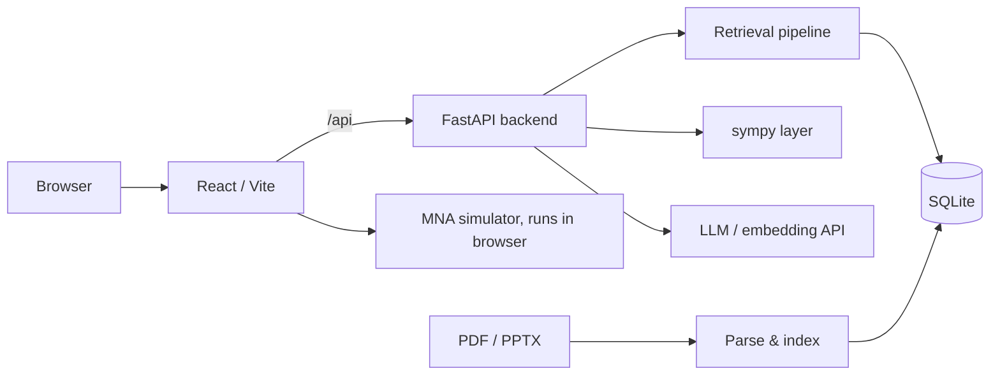

# CourseTA · Open-source course learning platform

[](https://github.com/lim20070714-jpg/course-ta/actions/workflows/ci.yml)
[](https://github.com/lim20070714-jpg/course-ta/releases)
[](LICENSE)
[](server/pyproject.toml)
[](server/app/main.py)
[](web/package.json)
[](web/package.json)

[中文](README.md) | **English**

Current version **v0.20.0** ([release](https://github.com/lim20070714-jpg/course-ta/releases/tag/v0.20.0) · [changelog](CHANGELOG.md)).

CourseTA turns course materials (PDF / PPTX / DOCX / TXT / MD / images) into a self-checkable study system: parse & index → full-text search → summaries with knowledge-point citations → concept graph → question bank with step-level grading → spaced repetition → timed mock exam → symbolic math workbench → circuit simulation. Every AI-generated answer carries `[source: filename, page X]` and resolves back to the rendered page image.

The UI is a **zone-based platform, not a chat wrapper**: eight zones, each a complete tool, with LLM features underneath rather than as the interface. Nothing is bound to a specific course, instructor or institution; materials, API keys and the database stay on your machine.

| | |
| --- | --- |
| Backend | FastAPI + SQLModel + SQLite, sympy kernel, custom retrieval pipeline |
| Frontend | React 19 + Vite + TypeScript, KaTeX, route-level lazy loading |
| API | 42 paths / 57 operations, streaming Q&A over SSE |
| Tests | 777 (349 backend / 428 frontend), fully offline, no API key required |
| Size | ~36.5k lines (`server/app` 6.6k + `server/tests` 4.5k + `web/src` 18.8k + CSS 6.5k) |
| License | MIT |

> `docs/API.md` and `docs/DEPLOY.md` are currently Chinese-only; the quick start below is self-contained.

## Quick start

Requires Python ≥ 3.12, [uv](https://docs.astral.sh/uv/), Node ≥ 20.

One command (Windows):

```bat
start.bat            # builds web/dist if missing, then opens http://127.0.0.1:8000
```

`start.bat` checks for `web/dist/index.html` rather than rebuilding every time, and warns when `server/.env` is absent (the app then runs in BYOK mode). With a build present the backend serves the frontend on the same port, so no Vite proxy is needed.

Manual start (two ports, better when editing frontend code):

```bash
# backend
cd server
uv sync
cp .env.example .env          # Windows: copy .env.example .env
# fill LLM_* and EMBEDDING_* with your own keys, or leave everything empty for BYOK mode
uv run uvicorn app.main:app --reload --port 8000

# frontend (separate terminal)
cd web
npm install
npm run dev                   # http://localhost:5173, /api proxied to localhost:8000
```

Minimum path on a fresh install:

1. Create a course.
2. Upload slides or exam papers → parsing and indexing run in the background; on completion a summary plus a knowledge-point list is generated. Opening a material shows the summary; clicking a page number next to a knowledge point jumps to the original page image. Tabs switch between text and page images; search covers the whole course.
3. Click *extract* on an exam paper in the question bank zone → structured problems (stem / reference answer / knowledge tags), step-level grading and material-grounded explanations. Explanations are generated once and stored, including the cited pages, so reopening a problem replays the cached text instead of paying for another call.
4. Click *generate* in the concept graph zone → course overview, modules ordered by prerequisites, concept network; clicking a concept jumps to its source page and linked problems.
5. The compute, lab, review, exam and trace zones work independently of steps 2–4.

Batch scripts:

```bash
cd server
uv run python scripts/extract_problems.py --all        # or --material-id 3
uv run python scripts/summarize.py --missing-only      # summaries for materials missing them
uv run python scripts/build_graph.py --course-id 1     # requires material summaries
uv run python scripts/generate_solutions.py --course-id 1   # only problems without answer or solution; --force regenerates
```

For the container path (two services, single exposed port 8080) see [docs/DEPLOY.md](docs/DEPLOY.md).

## Zones

| Zone (⌘/Ctrl+1..8) | Capability | Tables |
| --- | --- | --- |
| Materials | Upload PDF / PPTX / DOCX / TXT / MD / images; auto parse, index, summarize; paged reader, full-text search, citation jumps; delete and rename (display name and file on disk change together) | `Material` / `Chunk` / `Summary` |
| Question bank | Exam papers split into structured problems; filter by material / knowledge point / practice state; step-level grading (correct / partial / wrong); explanations grounded in course materials, generated once and persisted with their citations; wrong-answer notebook; original page images; problems without a reference answer are graded against their stored explanation | `Problem` / `Attempt` |
| Study trace | Attempts grouped by day: count, distinct problems, ever-wrong problems, streak length; filter by verdict and jump back to any explanation | `Attempt` |
| Review plan | SM-2 spaced repetition; a card is created or rescheduled automatically after each graded attempt (correct / partial / wrong → quality 5 / 3 / 1); exam sprint mode compresses intervals to before the exam date and re-ranks the due queue by topic frequency in the bank | `ReviewCard` / `Course.exam_date` |
| Timed exam | Random paper composition (problem count / duration / knowledge scope); server-authoritative deadline, survives reload, auto-submit on timeout; per-problem grading and percentage score; reference answers are not sent before grading finishes | `MockExam` / `ExamAnswer` |
| Compute | 20+ sympy operations (calculus / algebra / transforms / linear algebra / complex), 35 preset formulas, custom symbol assumptions; the live preview is the inline KaTeX expression itself — limits, variable, expansion point, order and every matrix cell are click-to-edit; all runs including failures are logged | `Formula` / `ComputeRun` |
| Concept graph | Two-stage extraction producing a prerequisite/related concept network; collapsible modules, tree sidebar, minimap; concepts anchored to page numbers and linked problems | `CourseGraph` / `Concept` / `ConceptEdge` |
| Circuit lab | In-house modified nodal analysis engine: DC operating point / transient / AC sweep; preset experiments plus a free-form schematic canvas; drawings stored server-side by name | `LabDrawing` |

## Architecture



- **Parsing.** PyMuPDF layout-level extraction keeps line breaks and structure; row clustering rebuilds visual lines so 2-D formulas and matrices are not shredded; Symbol / Wingdings / PUA / variant-character decoding, and garbled or fragmented pages are handed to an LLM to normalize into Markdown + LaTeX. Page images render on demand and page numbers are the anchor for every citation.
- **Retrieval and generation.** Vectors and metadata live in the same SQLite file; summarization, problem extraction and graph extraction each have their own prompt and model setting (`EXTRACT_MODEL` can point at a stronger model). All output carries page citations. When the embedding service is unavailable (not configured, or the request fails), retrieval degrades to term frequency — Chinese split into character bigrams, Latin by word, IDF-weighted — so Q&A, solutions and grading keep working with lower-precision citations.
- **Symbolic math.** `server/app/core/compute.py` accepts LaTeX and plain syntax and parses into sympy expressions. The frontend preview parser is format-aligned with it and covered by round-trip tests, so what the preview shows is what gets sent.
- **Simulation.** Modified nodal analysis runs in the browser (DC / transient / AC), including ideal op-amps and waveform sources; 111 tests.
- **Background jobs and state consistency.** Ingestion, summarization, graph building and grading run on FastAPI `BackgroundTasks` (in-process) while state lives in SQLite. On startup, [server/app/core/recovery.py](server/app/core/recovery.py) resets interrupted states once: materials / summaries / graphs → `failed` with an actionable `error`, exams → `running` (answers are already persisted per problem in `ExamAnswer`, so the paper stays workable and re-submittable).
- **Frontend robustness.** Each zone is wrapped in an error boundary (bad data or a failed chunk fetch collapses one zone only) and lazy-loaded per route; entry JS is 247 kB (78 kB gzipped).
- **Single-port hosting.** When `web/dist` exists the backend mounts `/assets` and falls back to `index.html`, so pages and `/api` share an origin. The fallback is a 404 handler rather than a catch-all route: only unmatched GETs reach the frontend, and `/api/*` 404s keep their original error message.

## Configuration

`server/.env` (gitignored; keys never committed). Per-item notes in [server/.env.example](server/.env.example).

| Variable | Purpose |
| --- | --- |
| `LLM_API_KEY` / `LLM_BASE_URL` / `LLM_MODEL` | Any OpenAI-compatible chat endpoint (DeepSeek / Qwen / Ollama / OpenAI) |
| `EMBEDDING_API_KEY` / `EMBEDDING_BASE_URL` / `EMBEDDING_MODEL` | Embedding model; DeepSeek has no embeddings endpoint, configure separately |
| `RETRIEVAL_MODE` | `auto` (vectors first, fall back to term frequency) / `vector` (vectors only) / `keyword` (term frequency only, no embedding calls) |
| `EXTRACT_MODEL` | Model used for problem extraction; falls back to `LLM_MODEL` |
| `VISION_MODEL` / `VISION_KEY` / `VISION_BASE` | Image-captioning model, may come from a different provider; if empty, captions are skipped and images remain uploadable/viewable |
| `CORS_ORIGINS` | Allowed frontend origins, comma-separated; must change when deployed to a domain |
| `DATA_DIR` | Data directory, default `server/data` (SQLite + originals + page images) |

## Keys and quota ownership (BYOK)

The server can hold no spendable key at all.

| Deployment | Configuration | Whose quota |
| --- | --- | --- |
| Local, self-use | your keys in `server/.env` | yours |
| Someone else's instance | keys in the in-app *settings* panel, sent as request headers | the visitor's |
| Shared instance | leave `LLM_API_KEY` empty | each visitor's own |

Request headers (also valid when calling the API directly):

| Header | Purpose |
| --- | --- |
| `X-LLM-API-Key` | Use the caller's own key |
| `X-LLM-Base-URL` / `X-LLM-Model` | Override chat endpoint and model |
| `X-Embedding-API-Key` / `X-Embedding-Base-URL` / `X-Embedding-Model` | Override embedding endpoint / key / model |
| `X-Vision-Model` | Override the captioning model |

```bash
# no header: uses server configuration
curl localhost:8000/api/chat -H 'Content-Type: application/json' -d '{"course_id":1,"question":"Thevenin theorem"}'

# with your own key: this request spends your quota, nothing is persisted server-side
curl localhost:8000/api/chat \
  -H 'X-LLM-API-Key: sk-your-own-key' \
  -H 'Content-Type: application/json' \
  -d '{"course_id":1,"question":"Thevenin theorem"}'
```

`GET /api/config` reports whether the server holds a key (`server_key_configured`) and which headers are honored; key values are never echoed. Forced-BYOK shared-instance configuration, CORS and HTTPS setup are in [docs/DEPLOY.md](docs/DEPLOY.md).

## Keyboard shortcuts

| Keys | Action |
| --- | --- |
| `⌘/Ctrl + K` | Command palette: fuzzy search over zones, courses and actions |
| `⌘/Ctrl + 1..8` | Switch zone |
| `↑ / ↓ / Enter / Esc` | Navigate / run / close in the palette |
| `[` `]`, `←/→`, `+/-`, `Home` (in graph) | Walk concepts in learning order, pan, zoom, fit |
| Slider focused + `←/→` (`Shift` ×10, `Alt` fine) | Nudge lab parameters; double-click resets to default |

## Tests and evaluation

```bash
cd server
uv run pytest                                        # 346 cases, fully offline (no API key)
uv run ruff check app tests                          # lint + format
uv run python ../evals/run_eval.py --dry-run         # validate eval set format
uv run python ../evals/run_eval.py --course-id 1     # live eval (needs .env + indexed materials)

cd ../web
npm run lint                                         # oxlint, 62 files
npx tsc -b                                           # type check
npm test                                             # 428 cases, 20 files
npm run build                                        # tsc -b && vite build
```

Frontend breakdown: simulator & builder & experiments 111 + graph layout & collapsible tree 102 + material grouping & search 62 + review sprint 33 + compute & history 35 + compute preview controls 30 + BYOK client 20 + lab drawings 8 + study trace 9 + rename & formula normalization 15 + zone error boundary 3. CI runs two jobs (web / server) in [`.github/workflows/ci.yml`](.github/workflows/ci.yml).

## Repository layout

```
course-ta/
├── server/                # FastAPI backend
│   ├── app/
│   │   ├── api/           # courses, materials, browsing & search, summaries, graph, SSE chat, problems, review & sprint, exams, compute & history, lab drawings
│   │   ├── core/          # LLM client, parsers, retrieval, sympy kernel & RAG, extraction & grading, summarization, graph, SM-2 & sprint compression, startup recovery
│   │   └── models.py      # Course / Material / Chunk / Problem / Attempt / Summary / Formula / CourseGraph / Concept / ConceptEdge / ReviewCard / ComputeRun / LabDrawing / MockExam / ExamAnswer
│   ├── scripts/           # reindex, batch extraction, batch summaries, graph build, batch explanation backfill
│   └── tests/             # 27 files
├── web/                   # React + Vite + TypeScript
│   └── src/
│       ├── sections/      # the eight zones
│       ├── compute/       # compute preview node algebra
│       ├── graph/         # graph layout and collapsible tree
│       ├── circuit/       # MNA simulator
│       └── labs/          # preset experiments and builder
├── evals/                 # eval set and runner
├── docs/                  # API / DEPLOY / HIGHLIGHTS
├── docker-compose.yml     # self-host orchestration (api + web)
└── data/                  # local data (materials, SQLite), gitignored
```

## Releases and upgrades

- The version lives in `FastAPI(version=...)` and in git tags (`v0.20.0`); every tag maps to a GitHub Release, entries in [CHANGELOG.md](CHANGELOG.md).
- Upgrade: `git pull` → `cd server && uv sync` → `cd web && npm ci && npm run build` → restart services. Schema is created by `init_db()` at startup; the `solution` / `solution_citations` columns are added to an existing `problem` table automatically, preset formulas migrate with the version, uploaded materials and attempt records are untouched.
- The first startup after upgrading from v0.18 or earlier runs one state reset (see *Background jobs and state consistency*): materials / summaries / graphs stuck in progress become `failed` with a remediation hint, exams stuck in `grading` return to a workable state.
- Full deployment, backup and rollback steps: [docs/DEPLOY.md](docs/DEPLOY.md).

## Supported input formats

| Format | Handling |
| --- | --- |
| PDF / PPTX | Layout-level text extraction + optional LLM normalization; page images on demand |
| DOCX | Headings / lists / tables keep structure; embedded images exported as their own pages |
| TXT / MD | Indexed directly |
| Images (PNG / JPG / WEBP / GIF / BMP / TIFF) | Viewable as page 1; with `VISION_MODEL` set, a caption is generated and indexed for retrieval |

## Data and privacy

- Course materials, the SQLite database and page images are written only to local `data/` (gitignored) and never enter the repository.
- API keys live in `server/.env` (gitignored) or in the visitor's browser; BYOK keys are not persisted or echoed by the server.
- Do not upload materials you are not authorized to use to a public instance.
- Citation format exists for one reason: any answer should be traceable to a page of the original material.

## License

[MIT](LICENSE)
