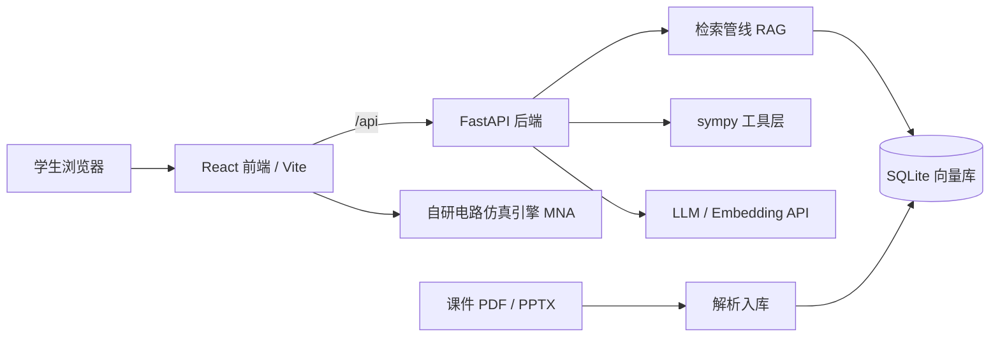

# CourseTA · 开源课程学习平台

[](https://github.com/lim20070714-jpg/course-ta/actions/workflows/ci.yml)
[](LICENSE)
[](server/pyproject.toml)
[](server/app/main.py)
[](web/package.json)
[](web/package.json)

把任意一门课的课件（PDF / PPTX）变成**可检索、可练习、可视化的学习系统**：上传课件自动生成知识点总结与讲解（点击知识点直达原页）、按学科脉络自动构建的知识图谱（概念网络含前置关系，点击概念跳原页、连题目）、带引用的 AI 答疑、题库与解答、可自定义公式与符号的计算台、电路仿真实验台。答案标注 `[来源: 文件名 第X页]`，可逐条核对。

> 面向所有学生的通用工具：不绑定某一门课、某一位老师、某所学校。上传你课程的材料，它就是你课程的学习平台。
>
> Turn any course's materials (PDF / PPTX) into a citation-backed learning platform: AI summaries with clickable knowledge points that jump to the source page, an auto-built concept map of the course, practice exam questions with step-level grading, a customizable symbolic-math workspace, and circuit simulation — every AI answer cites its source page.

**技术亮点与工程指标**（一页纸：难点、解法、718 个测试怎么分布、如何复现）见 [docs/HIGHLIGHTS.md](docs/HIGHLIGHTS.md)。

## 平台分区一览

平台即分区，不是聊天套壳：每个分区是一件完整的学习工具，AI 能力沉在底层做支撑。

| 分区（⌘/Ctrl+1..8 直达） | 做什么 |
| --- | --- |
| 课程资料 | 上传课件 / 教材 / 试卷（PDF / PPTX / DOCX / TXT / MD / 图片），自动解析入库并生成「整体总结 + 知识点清单」，逐页阅读、全文搜索，点击引用直达原页；传错或重复的可以随时删（已练过的题目会保留在题库），名字取错了也可以改（磁盘上的原件一起改名） |
| 题库与解答 | 试卷自动拆成结构化题目（题干 + 参考答案 + 知识点标签），作答后步骤级批改、AI 详解结合课程材料、错题自动收录 |
| 做题足迹 | 按天回看这门课练过什么：作答次数、练过的题数、曾经做错过几道、连续打卡天数，可按判定筛选并从任意一条跳回题目详解 |
| 复习计划 | SM-2 间隔重复 + 考试冲刺模式：设置考试日期后自动压缩复习间隔、按考点热度加权排序、倒计时提醒 |
| 限时模考 | 从题库随机组卷（可按知识点圈定），倒计时以服务端为准、刷新不重置；交卷后逐题步骤级批改并给出百分制得分，未掌握的题一键进复习计划 |
| 计算台 | sympy 符号计算 20+ 操作（微积分 / 代数 / 变换 / 线性代数 / 复数），预置 35 条常用公式，自定义符号类型，KaTeX 渲染 + 数值近似；实时预览本身就是一条行内 KaTeX 算式，上下限 / 变量 / 展开点 / 阶数是式子里可点击的数学值，点一下就地改、回车重算；空着上下限会明确告诉你「这是不定积分」而不是假装无穷限；每次运算（含没算出来的）都会留下历史，点一条就把表达式与参数搬回输入框 |
| 知识图谱 | AI 通读全部材料，按学习顺序生成概念网络（前置 / 相关关系），模块可折叠、树形导航；点击概念直达出处原页与关联真题 |
| 电路实验台 | 自研电路仿真引擎（改进节点法）：预置参数实验（RLC 阶跃 / RC 方波 / Sallen-Key…）+ 自由搭建画布，直流 / 瞬态 / 交流三视图分析；画布可以按名字存成图纸放在服务端，换浏览器也能载回来接着画 |

## 它解决什么问题

- 课件几百页，考前翻不动：直接提问，答案定位到页
- 只想快速回忆一份课件讲了什么：自动生成「整体总结 + 知识点清单」，点击知识点的页码直接跳到原页图，不用逐页翻查
- 复习时理不清整门课的脉络：知识图谱按学习顺序把概念串成网络，标出前置与相关关系，点开概念直达原页与相关真题
- 答疑时间有限：夜间、周末也能得到有材料依据的回答
- 通用聊天机器人容易编造：CourseTA 的答案必须引用课程材料，材料不足会明确说明
- 想刷真题但只有 PDF：试卷自动拆成结构化题目，提交作答后逐步批改，指出出错的位置，错题自动收录

## 架构



## 功能进度

- [x] 课程管理、材料上传、后台自动解析入库（PDF / PPTX / TXT / MD）
- [x] 带引用的流式问答（SSE）
- [x] sympy 数学工具（解方程、推导步骤等价性验证）
- [x] 自研电路仿真引擎（改进节点法：直流工作点 / 瞬态 / 交流扫频）
- [x] 交互实验台 v0.2：5 个预置实验（分压器 / RC / RL / RC 低通 / RLC 谐振）+ 参数滑块 + 波形与波特图
- [x] 评测集与自动评测脚本（按关键点命中率打分）
- [x] v0.3 课程资料分区：材料分类浏览、分页阅读器、全文搜索、引用跳转 + 分区导航（资料 / 题库 / 图谱 / 实验台）
- [x] v0.3.1 解析与排版质量：PyMuPDF 版面级抽取（保留换行与结构）、PPT 层级结构、助教解答 Markdown + KaTeX 公式渲染
- [x] v0.4 题库与解答：真题自动解析为结构化题目（题干 + 参考答案 + 知识点标签）、按材料 / 知识点 / 练习状态筛选、作答步骤级批改（正确 / 部分正确 / 错误）、结合课程材料的 AI 详解、错题本、原题页图回看
- [x] v0.4.1 解析管线 v2：行聚类重建视觉行（修复 2D 公式/矩阵被拆成碎片行）、特殊字体与乱码解码（Symbol / Wingdings / PUA / 异体字符表）、大定界符组合件合并、LLM 语义修复（乱码或碎片页面自动整理为 Markdown + LaTeX）
- [x] v0.4.2 材料知识点总结：上传后自动生成「整体总结 + 知识点清单」（理工科优化：定义 / 定理 / 关键公式 / 方法优先），知识点带来源页码、点击直达原页图或原文；支持一键重新生成
- [x] v0.4.3 计算台：sympy 符号计算（化简 / 求导 / 积分 / 极限 / 级数 / 拉普拉斯与逆变换 / 解方程 / 行列式 / 特征值 / 复变留数等 20+ 操作），支持 LaTeX 与普通语法输入、实时预览、数值近似；预置 24 条常用公式（高数 / 线代 / 物理 / 电子 / 复变）并可自由新增编辑，符号可自定义类型（实数 / 正数 / 整数 / 复数）
- [x] v0.5 知识图谱：从材料总结两级抽取（按材料归纳候选概念 → 全局合并为脉络），输出课程总览、模块分组、概念解释与「前置 / 相关」关系，模块顺序按前置关系自动校正（先修在前，互相依赖的模块整体保持原序）；交互式概念网络（模块分带着色、滚轮缩放、拖拽平移），概念锚定到原始课件页码（点击跳原页），并自动关联题库中知识点匹配的真题（点击直达题目）
- [x] v0.5.1 计算台增强：按普适数学分支分类（微积分 / 代数 / 变换 / 线性代数 / 复数 / 物理与工程），新增偏导数、泰勒展开、傅里叶变换（ω 约定）/逆变换、定积分上下限与数值近似兜底；预置公式扩充到 35 条并随版本自动迁移；输入兼容混用花括号的写法（如 `e^{-x^2}`）
- [x] v0.6 电路实验台自由搭建：元件库画布编辑器、理想运放引擎与三视图分析面板
- [x] v0.7 复习板块：SM-2 间隔重复调度、复习分区与题库集成
- [x] v0.8 参数实验场：RLC 阶跃、RC 方波与 Sallen-Key 有源滤波三个新实验
- [x] v0.8.1 深色模式与示波器仪器风：全局设计 token 化
- [x] v0.8.2 动效包：复习卡 3D 翻转、电路图电流流动与全局过渡
- [x] v0.9 考试冲刺模式：设置课程考试日期后进入冲刺期（考前 30 天内），SM-2 间隔按剩余天数压缩到考试之前（考前 1 天内压到半天），到期队列改为按考点热度加权排序并纳入尚未到期的卡片（可提前推进），界面显示倒计时、冲刺阶段与「为什么排在前面」的加权理由
- [x] v0.10 图谱导航重构与资料分区：知识图谱支持模块折叠（折叠后布局只排可见节点，图真的会变短）、树形层级侧栏、缩略图导航器与缩放 / 偏移滑块，不再依赖鼠标拖拽理脉络；课程资料按类型分区（试题 / 课件 / 图片 / 教材 / 讲义 / 其他），可直接在分区内上传且在选择文件前就显示上传目标；新增 Word 文档与图片材料支持，图片可经视觉模型生成文字描述并参与检索与总结
- [x] v0.11 审美与动效升级：修复浅色主题阴影 token 自引用（此前所有浅色卡片/面板都没有层次）、统一动效 token（时长 / 缓动 / 层次 / 焦点环）并全套降级到 `prefers-reduced-motion`；新增 ⌘/Ctrl+K 命令面板（模糊搜索功能、课程与操作，⌘/Ctrl+1..6 直切分区）与 ⌘/Ctrl+K 之外的学习顺序遍历；图谱加入聚焦模式、学习顺序遍历（`[` `]`）、面包屑与按模块显示真题数，视口缩放/居中/缩略图跳转改为可中断的缓动动画；实验台加入测量游标（Δx、等效 1/Δx Hz、各曲线 Δy）、导出 CSV、图例开关、滑块键盘微调与原理图实时参数标注；计算台加入复制结果 / 复制 LaTeX / 作为输入
- [x] v0.12 资料分区收纳：课程资料分区可折叠（与知识图谱的模块收纳同一套交互：点击标题展开/收起、折叠后显示「N 份已收起」与虚线轮廓、折叠状态持久化），新增「全部展开 / 全部收起」，收起分区后仍保留「上传」按钮可直接归档到该分区
- [x] v0.13 自带密钥（BYOK）与开源自托管：服务端密钥可以留空，使用者在页面右上角「设置」填入自己的 API Key 后按请求头下发（`X-LLM-API-Key` / `X-LLM-Base-URL` / `X-LLM-Model` / 嵌入与视觉模型各一组），密钥只存在本机 localStorage、服务端不保存也不回显；`docker-compose.yml` + `docs/DEPLOY.md` 一条命令起服务，本机统一用 `http://localhost:8080` 打开；视觉模型可独立于主模型配置
- [x] v0.14 限时模考：从题库随机组卷（可限定题数、时长与知识点范围，只有带参考答案的题目参与组卷），倒计时与交卷判定全部以服务端为准、刷新页面不重置，作答内容自动暂存并在交卷时一并落盘；到点自动交卷并标记超时，交卷后逐题步骤级批改给出「正确 / 部分正确 / 错误 / 未作答」与助教点评，按权重折算百分制得分；参考答案在批改完成前不下发，未掌握的题可一键加入复习计划、点评可跳题库看完整详解
- [x] v0.15 学习足迹与可修改的命名：课程可以改名、资料可以重命名（显示名与磁盘上的原件一起改，后台还在处理时先拒绝以免串数据）；新增第 8 个分区「做题足迹」，按天回看这门课做过哪些题、哪道曾做错、连续打卡几天；计算台的历史（含没算出来的报错）会存下来，点一条即可把表达式与参数搬回输入框；实验台画布支持按名字保存图纸到服务端（命名 / 覆盖 / 另存 / 载入 / 删除），换浏览器也能接着画
- [x] v0.16 计算台：参数长在公式里改。上下限、积分变量、展开点、阶数不再是下面那排独立输入框，而是嵌进实时预览的槽位——定积分的 `∫` 直接带可编辑的上、下限角标，`d` 后面跟着可编辑的变量，泰勒展开写成「在 x = 0 处展到 6 阶」，改哪个数字就是改哪个参数；槽位集合由一张纯函数节点表推导，并与后端真正吃的参数做了不变量一致性测试，不会出现「给了个改了没用的框」
- [x] v0.17 计算台预览重做：算式不再是由控件拼出来的假公式，整条式子走同一套行内 KaTeX 渲染，参数是**式子里可点击的数学值**——点一下才变成输入框，回车直接重算，Esc 取消；预览与后端默认值对齐（变量空着按 `x`、展开点按 `0`、阶数按 `1`），上下限空着不再用 `±∞` 冒充，而是显示空心槽并写明「上下限不填就是不定积分」；快捷符号面板默认收起、只常驻 10 个，区块顺序改为输入 → 操作与计算 → 算式 → 符号
- [ ] v0.18 多课程公开部署、老师端数据面板

## 快速开始

### 1. 后端（Python ≥ 3.12，使用 uv）

```bash
cd server
uv sync
cp .env.example .env   # Windows: copy .env.example .env
# 编辑 .env，填入 LLM_API_KEY 与 EMBEDDING_*（都填你自己的 Key，额度走你的账号；
# 也可以都留空，让使用者在页面「设置」里自带密钥，见下文「给别人的用法」）
uv run uvicorn app.main:app --reload
```

### 2. 前端（Node ≥ 20）

```bash
cd web
npm install
npm run dev
```

打开 http://localhost:5173 ：新建课程 → 上传课件。上传后系统自动解析入库并生成「知识点总结」：打开材料默认看到整体总结与知识点清单（含公式渲染），点击知识点旁的页码直接跳到原页图；右上「原文 / 原页图」标签可切换逐页阅读，上方可全文搜索，需要时拉起右栏「问助教」，引用可点击跳页。

切换到「知识图谱」分区：点「生成」后，AI 通读该课程全部材料总结，归纳课程总览、按学习顺序排列的知识模块、概念解释与前置 / 相关关系，在画布上生成可交互概念网络（模块按顺序自上而下分带着色、滚轮缩放、拖拽平移、左侧列表搜索）。点击任一概念：右侧显示解释与关联概念，可一键跳到出处课件的对应页码，并列出知识点标签匹配的真题（点击直达题库作答）。

切换到「计算台」分区：左侧公式库预置 35 条常用公式，按普适数学分支组织（微积分 / 代数 / 变换 / 线性代数 / 复数 / 物理与工程，可新增、编辑、删除），点公式即插入表达式；输入支持 LaTeX（`\int_0^{\infty} e^{-x^2} dx`）与普通语法（`x^3-3x+2`、`e^{-x^2}`），可选择求导 / 偏导 / 定积分 / 极限 / 泰勒展开 / 傅里叶与拉普拉斯变换 / 解方程 / 矩阵运算 / 复变函数等操作，结果 KaTeX 渲染并给出数值近似。参数不用在别处找框填：实时预览就是那条要算的式子本身，走同一套行内 KaTeX 渲染，定积分的 `∫` 带着上、下限角标，`d` 后面是变量，极限在 `lim` 下方写「x → 0」，泰勒展开写成「在 x = 0 处展到 6 阶」——这些位置看着就是数学值，点一下才变成输入框，改完按回车直接重算。上下限空着时不假装是无穷限，而是显示空心槽并提示「上下限不填就是不定积分」，与后端真实行为一致。右侧可自定义符号及其类型（如实数 / 正数 / 整数），让化简结果符合物理语境。下方「计算历史」按天列出最近的运算（包括没算出来的那些），点一条就把表达式、操作与参数原样搬回输入框并显示当时记下的结果，可以一边推一边回看自己是怎么算岔的。

切换到「题库与解答」分区：在左侧找到真题材料点「提取」，AI 会把试卷拆成结构化题目（题干、参考答案、知识点标签）；点开题目即可作答、提交批改（分步点评 + 判定）、生成结合课程材料的 AI 详解；判定为「错误 / 部分正确」的题自动进入错题本。批量提取全部真题可用：

```bash
cd server
uv run python scripts/extract_problems.py --all        # 或 --material-id 3
uv run python scripts/summarize.py --missing-only      # 为尚未总结的材料批量生成知识点总结
uv run python scripts/build_graph.py --course-id 1     # 生成课程知识图谱（需先完成材料总结）
```

切换到「复习计划」分区：题库题目页点「加入复习计划」后，卡片按 SM-2 间隔（1 天 → 6 天 → 按难度系数递增）安排到期复习，自评「忘了 / 困难 / 良好 / 轻松」会写回调度状态。**设置考试日期后进入考试冲刺模式**（考前 30 天内）：

- 倒计时与冲刺阶段（基础巩固 / 强化冲刺 / 考前收尾 / 临考突击）
- 复习间隔自动压缩到考试之前（考前 1 天内压缩为半天），且只会缩短、绝不拉长已有间隔
- 到期队列按「考点热度」加权排序：某个知识点在题库里出现的题目越多，关联卡片越靠前，并标注加权理由（高频知识点 / 已到期 / 已遗忘 N 次）
- 冲刺期队列会纳入尚未到期的卡片，可以提前推进最可能考到的内容；非冲刺期行为与之前完全一致

切换到「限时模考」分区可以按真实考试节奏刷题：设定题数、时长与知识点范围后从题库随机组卷，倒计时由服务端权威给出（`deadline_at = started_at + duration`），刷新页面不会重置、到点自动交卷；作答内容边写边自动暂存，交卷时先 flush 再批改，逐题产出步骤级点评与百分制得分，未掌握的题可一键加入复习计划。

「做题足迹」分区回答的是另一个问题：**这门课我到底练过什么**。按天列出每次作答（题号、出处材料与页码、题干摘录、批改点评），顶部给出作答次数、练过的题数、曾经做错的题数（后来做对也算错过）与连续打卡天数，可按「做对 / 半对 / 做错 / 待批改」筛选，任意一条都能跳回题库看完整详解。删掉一份材料不会抹掉从它切出来的题目与作答记录，这些题仍留在足迹里，只是来源显示为「来源已删除」。

材料名字与课程名字都取得回来：资料列表每行有「改名」，改完显示名与磁盘上的原件一起改名（`data/materials/{课程}/{文件名}`），原页图按材料 id 存放不受影响；后台还在入库 / 总结 / 拆题时会先拒绝，避免处理结果落到被复用的 id 上。实验台画布右上角可以按名字保存图纸（保存 / 覆盖 / 另存 / 载入 / 删除），画布内容存到服务端，本地暂存只作兜底，换浏览器或重装后还能载回来接着画。

```bash
# 设置 / 清除考试日期（也可在界面「复习计划」顶部直接选日期）
curl -X PUT localhost:8000/api/courses/1/exam-date \
  -H "Content-Type: application/json" -d '{"exam_date":"2026-11-20"}'
curl localhost:8000/api/courses/1/review/sprint   # 冲刺概览与高频考点
```

### 键盘快捷键

| 快捷键 | 作用 |
| --- | --- |
| `⌘/Ctrl + K` | 打开命令面板：模糊搜索全部分区、课程与操作 |
| `⌘/Ctrl + 1..8` | 直接切换到对应分区 |
| `↑ / ↓ / ↵ / Esc` | 命令面板内选择 / 执行 / 关闭 |
| 图谱内 `[` `]`、`←/→`、`+/-`、`Home` | 按学习顺序上一个 / 下一个概念、平移、缩放、缩放适应 |
| 实验台滑块聚焦后 `←/→`（`Shift` ×10、`Alt` 精调） | 微调参数；双击滑块恢复默认 |

### 配置说明

| 变量 | 说明 |
| --- | --- |
| `LLM_API_KEY` / `LLM_BASE_URL` / `LLM_MODEL` | 任意 OpenAI 兼容对话接口（DeepSeek / Qwen / Ollama…） |
| `EMBEDDING_API_KEY` / `EMBEDDING_BASE_URL` / `EMBEDDING_MODEL` | 向量模型（如 DashScope `text-embedding-v3`、Ollama `bge-m3`）；注意 DeepSeek 暂无 embeddings 接口，需单独配置 |
| `EXTRACT_MODEL` | 题目抽取专用模型（可选，默认同 `LLM_MODEL`）。抽取是一次性批量任务，建议用更强的模型保证公式与结构质量 |
| `VISION_MODEL` | 图片描述专用视觉模型（可选，需支持图片输入）。配置后图片上传即生成中文描述，描述作为该页正文参与检索、知识总结与图谱引用；留空则跳过描述，图片仍可上传与查看 |
| `VISION_BASE` / `VISION_KEY` | 视觉模型可以**来自与对话模型不同的服务商**：留空则复用 `LLM_BASE_URL` / `LLM_API_KEY`。例如对话继续用 SiliconFlow 的 Qwen、图片理解改用 DeepSeek 时，只需填这两项指向 DeepSeek |

#### 换成 DeepSeek 的视觉模型

DeepSeek 自 2026-08 起提供多模态模型，模型名为 **`deepseek-flash`**（旧的
`deepseek-v4-flash-vision-exp` 已下线但仍可调用）。它使用标准 OpenAI 图像格式
（`content` 为块数组 + `image_url` data URL），与本项目已有实现一致，因此**只需改配置**：

```bash
VISION_MODEL=deepseek-flash
VISION_BASE=https://api.deepseek.com/v1
VISION_KEY=sk-你的DeepSeek密钥
```

图片按 token 计费，单图上限约 1024 tokens；对话与向量仍走原服务商，互不影响。
改完重启后端即可，可在「课程资料」上传一张图片验证是否生成描述。

### 支持的材料格式

| 格式 | 处理方式 |
| --- | --- |
| PDF / PPTX | 版面级文本抽取 + 可选 LLM 排版修复；原页图按需渲染 |
| DOCX | 标题 / 列表 / 表格保留结构；内嵌图片导出为独立页，可直接查看原图 |
| TXT / MD | 直接入库 |
| 图片（PNG / JPG / WEBP / GIF / BMP / TIFF） | 本身作为第 1 页可查看；配置 `VISION_MODEL` 后生成文字描述并入库检索 |

## 给别人的用法（不用花我的额度）

这个项目开源的目的就是**任何人可以自己跑一份**。三条路，花谁的额度一目了然：

| 用法 | 怎么用 | 花谁的 token |
| --- | --- | --- |
| **自己本地跑**（推荐） | 克隆仓库 → 装依赖 → 在 `server/.env` 填自己的 Key | 自己的 |
| **用别人部署的实例** | 打开网页 → 右上角「设置」填自己的 Key（自带密钥 / BYOK） | 自己的 |
| **部署一台共享实例** | Docker Compose 起服务，**`.env` 里不填 `LLM_API_KEY`** | 每个访问者各自承担 |

### 自带密钥（BYOK）

访问者可以在界面右上角「设置」里填自己的 API Key、接口地址与模型。密钥**只保存在访问者的浏览器**，
随请求头发给服务端**按次使用、不落库**；因此共用别人的实例时，消耗的是填写者自己的额度。

请求头（供直接调 API 的人使用）：

| 请求头 | 说明 |
| --- | --- |
| `X-LLM-API-Key` | 必填，使用自己的密钥 |
| `X-LLM-Base-URL` | 可选，覆盖接口地址（如本地 Ollama `http://localhost:11434/v1`） |
| `X-LLM-Model` | 可选，覆盖对话模型 |
| `X-Embedding-API-Key` | 可选，向量模型密钥；对话服务商不提供 embeddings 时单独给（如 DeepSeek + DashScope） |
| `X-Embedding-Base-URL` | 可选，覆盖向量接口地址 |
| `X-Embedding-Model` | 可选，覆盖向量模型 |
| `X-Vision-Model` | 可选，覆盖图片描述模型 |

```bash
# 不带密钥：使用服务端配置（部署者额度）
curl localhost:8000/api/chat -H 'Content-Type: application/json' -d '{"course_id":1,"question":"戴维南定理"}'

# 带自己的密钥：本次请求使用你的额度，服务端不保存
curl localhost:8000/api/chat \
  -H 'X-LLM-API-Key: sk-your-own-key' \
  -H 'Content-Type: application/json' \
  -d '{"course_id":1,"question":"戴维南定理"}'
```

`GET /api/config` 会返回服务端是否配置了密钥、以及上述请求头名称（**不会回显密钥本身**）。
如果你把实例开放给别人又不想被消耗额度：**把 `.env` 里的 `LLM_API_KEY` 留空** —— 此时服务端没有可消耗的密钥，
所有人必须填自己的 Key 才能使用 AI 功能，界面也会明确提示。

> 部署到域名后记得设置 `CORS_ORIGINS`，否则浏览器跨域会拦住请求。

### API 文档

- 交互式文档（Swagger UI）：`http://localhost:8000/docs`（本机；远程部署换成你的地址）
- 备用文档（ReDoc）：`/redoc`；OpenAPI JSON：`/openapi.json`
- 中文接口说明与 SSE 接入示例：见 [docs/API.md](docs/API.md)
- 自托管部署（本机 / Docker / 反向代理）见 [docs/DEPLOY.md](docs/DEPLOY.md)
- 技术亮点与工程指标（一页纸）见 [docs/HIGHLIGHTS.md](docs/HIGHLIGHTS.md)

### 测试与评测

```bash
cd server
uv run pytest                                        # 后端单元测试：315 个用例，全程离线（不需要 API key）
uv run python ../evals/run_eval.py --dry-run         # 校验评测集格式
uv run python ../evals/run_eval.py --course-id 1     # 真实评测（需已配置 .env 且材料已入库）

cd ../web
npm run lint                                         # 前端静态检查（oxlint，60 个文件）
npm test                                             # 前端测试：403 个用例、19 个文件（仿真引擎与搭建器与实验 111 + 图谱布局与折叠树 102 + 资料分组与搜索 62 + 复习冲刺 33 + 计算台与计算历史 27 + 计算台实时预览控件 16 + BYOK 客户端 20 + 实验台图纸 8 + 做题足迹分组 9 + 改名与公式规范化 15）
```

## 目录结构

```
course-ta/
├── server/            # FastAPI 后端
│   ├── app/
│   │   ├── api/       # 接口：课程、材料、资料浏览、材料总结、知识图谱、流式聊天、题库（抽取 / 批改 / 详解 / 错题本）、复习计划与考试冲刺、计算台与公式库
│   │   ├── core/      # LLM 客户端、文档解析（PDF / PPTX / DOCX / 图片）、检索、sympy 工具与符号计算内核、RAG、题目抽取与批改、材料总结、图谱抽取、SM-2 调度与冲刺压缩
│   │   └── models.py  # Course(含 exam_date) / Material(含 pages 图片页) / Chunk / Problem / Attempt / Summary / Formula / CourseGraph / Concept / ConceptEdge / ReviewCard / ComputeRun(计算历史) / LabDrawing(实验台图纸)
│   ├── scripts/       # 重新索引、批量真题抽取、批量总结、图谱生成 CLI
│   └── tests/
├── web/               # React + Vite + TypeScript 前端（src/sections 分区页面、src/compute 计算台、src/graph 图谱布局与折叠树、src/circuit 仿真引擎、src/labs 预置实验）
├── evals/             # 评测集与评测脚本
└── data/              # 本地数据（课程材料、向量库），已 gitignore
```

## 版权与隐私

- 课程材料保存在本地 `data/` 目录（已 gitignore），不会进入代码仓库
- 请勿把未授权的课程材料上传到公开部署实例
- 引用格式的设计目标：任何回答都能被学生追溯到原始材料的页码

## 许可证

[MIT](LICENSE)
