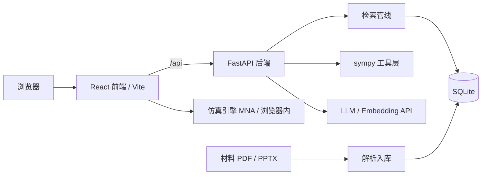

# CourseTA · 开源课程学习平台

[](https://github.com/lim20070714-jpg/course-ta/actions/workflows/ci.yml)
[](https://github.com/lim20070714-jpg/course-ta/releases)
[](LICENSE)
[](server/pyproject.toml)
[](server/app/main.py)
[](web/package.json)
[](web/package.json)

**中文** | [English](README.en.md)

当前版本 **v0.20.0**（[Release](https://github.com/lim20070714-jpg/course-ta/releases/tag/v0.20.0) · [更新记录](CHANGELOG.md)）。

把课程材料（PDF / PPTX / DOCX / TXT / MD / 图片）转换成一套可自查的学习系统：解析入库 → 全文检索 → 总结与知识点引用 → 概念图谱 → 题库与步骤级批改 → 间隔重复复习 → 限时模考 → 符号计算 → 电路仿真。所有 AI 产出带 `[来源: 文件名 第X页]`，可逐条回溯到原始页图。

形态上是一个**分区式平台，不是对话套壳**：8 个分区各是一件完整工具，AI 能力沉在分区内部做支撑。不绑定课程、教师或学校，材料、密钥、数据库全部留在本机。

| 项 | 值 |
| --- | --- |
| 后端 | FastAPI + SQLModel + SQLite，sympy 符号计算内核，自研检索管线 |
| 前端 | React 19 + Vite + TypeScript，KaTeX，按分区懒加载 |
| 接口 | 42 条路径 / 57 个操作，问答走 SSE |
| 测试 | 774 个（后端 346 / 前端 428），全程离线，不需要 API key |
| 代码规模 | 约 36.5k 行（`server/app` 6.6k + `server/tests` 4.5k + `web/src` 18.8k + 样式 6.5k） |
| 许可 | MIT |

## 文档

| 文件 | 内容 |
| --- | --- |
| [README.en.md](README.en.md) | English overview, quick start, configuration |
| [CHANGELOG.md](CHANGELOG.md) | v0.1–v0.19 完整更新记录 |
| [docs/HIGHLIGHTS.md](docs/HIGHLIGHTS.md) | 九个技术难点、工程指标、复现步骤（一页纸） |
| [docs/API.md](docs/API.md) | 接口清单、BYOK 请求头、SSE 帧格式与接入示例 |
| [docs/DEPLOY.md](docs/DEPLOY.md) | 实装指南：本机 / Docker Compose / 反向代理 / 升级 / 备份 / 安全清单 |

## 快速开始

环境：Python ≥ 3.12、[uv](https://docs.astral.sh/uv/)、Node ≥ 20。

一条命令（Windows）：

```bat
start.bat            # 缺构建产物时自动 npm install + build，然后开 http://127.0.0.1:8000
```

`start.bat` 只检查 `web/dist/index.html` 是否存在，不重复构建；`server/.env` 缺失时给出提示并继续（进入 BYOK 模式）。构建产物在时后端单端口托管前端，不需要另外跑 Vite。

手动启动（前后端分端口，适合改前端代码）：

```bash
# 后端
cd server
uv sync
cp .env.example .env          # Windows: copy .env.example .env
# 编辑 .env 填入 LLM_* 与 EMBEDDING_*（用自己的 Key）；全部留空则进入 BYOK 模式
uv run uvicorn app.main:app --reload --port 8000

# 前端（另开终端）
cd web
npm install
npm run dev                   # http://localhost:5173，/api 代理到 localhost:8000
```

首次使用的最小路径：

1. 新建课程。
2. 上传课件或试卷 → 后台自动解析入库，完成后生成「整体总结 + 知识点清单」；材料页默认显示总结，点击知识点旁的页码跳到原页图，「原文 / 原页图」可切换，顶部支持全文搜索。
3. 在「题库与解答」对试卷点「提取」→ 结构化题目（题干 / 参考答案 / 知识点标签），作答后可步骤级批改与 AI 详解；详解生成一次即落库，下次直接读缓存，引用过的材料页一并保存。
4. 在「知识图谱」点「生成」→ 通读该课程全部总结，产出课程总览、按学习顺序排列的模块与概念网络，点击概念跳出处原页与关联真题。
5. 「计算台」「电路实验台」「复习计划」「限时模考」「做题足迹」不依赖前四步，随时可用。

批量操作可用脚本：

```bash
cd server
uv run python scripts/extract_problems.py --all        # 或 --material-id 3
uv run python scripts/summarize.py --missing-only      # 为未总结的材料批量生成
uv run python scripts/build_graph.py --course-id 1     # 需先完成材料总结
uv run python scripts/generate_solutions.py --course-id 1   # 只补「无答案且无详解」的题，可 --force 重生成
```

容器方式（api + web 两个服务，对外只有 8080）见 [docs/DEPLOY.md](docs/DEPLOY.md)。

## 平台分区

| 分区（⌘/Ctrl+1..8） | 能力 | 落库 |
| --- | --- | --- |
| 课程资料 | 上传 PDF / PPTX / DOCX / TXT / MD / 图片，自动解析入库并生成总结与知识点清单；分页阅读、全文搜索、引用跳页；可删除、可改名（显示名与磁盘原件一起改） | `Material` / `Chunk` / `Summary` |
| 题库与解答 | 试卷拆结构化题目，按材料 / 知识点 / 练习状态筛选；步骤级批改（正确 / 部分正确 / 错误）、结合课程材料的 AI 详解（生成一次落库、引用页一并保存）、错题本、原题页图回看；无答案的题以 AI 详解作批改参考 | `Problem` / `Attempt` |
| 做题足迹 | 按天回看作答：次数、题数、曾做错题数、连续天数，按判定筛选并跳回详解 | `Attempt` |
| 复习计划 | SM-2 间隔重复；作答判定正确 / 部分正确 / 错误后自动建卡或重排；设置考试日期进入冲刺模式（间隔压缩到考前、按考点热度加权、倒计时与理由标注） | `ReviewCard` / `Course.exam_date` |
| 限时模考 | 随机组卷（题数 / 时长 / 知识点范围），服务端权威倒计时，刷新不重置，到点自动交卷；逐题批改与百分制得分，参考答案在批改完成前不下发 | `MockExam` / `ExamAnswer` |
| 计算台 | sympy 符号计算 20+ 操作（微积分 / 代数 / 变换 / 线性代数 / 复数），预置 35 条公式，自定义符号类型；实时预览即行内 KaTeX 算式，上下限 / 变量 / 展开点 / 阶数与矩阵每一格就地可改；每次运算含失败都记历史 | `Formula` / `ComputeRun` |
| 知识图谱 | 两级抽取生成概念网络（前置 / 相关），模块折叠、树形导航、缩略图；概念锚定原页码并关联真题 | `CourseGraph` / `Concept` / `ConceptEdge` |
| 电路实验台 | 自研仿真引擎（改进节点法）：直流工作点 / 瞬态 / 交流扫频；预置实验与自由搭建画布，图纸按名字存服务端、换浏览器可载回 | `LabDrawing` |

## 架构



- **解析**：PyMuPDF 版面级抽取保留换行与结构，行聚类重建视觉行（2D 公式与矩阵不被拆成碎片行），Symbol / Wingdings / PUA / 异体字符解码，乱码或碎片页面交给 LLM 整理为 Markdown + LaTeX。原页图按需渲染，页码是所有引用的锚点。
- **检索与生成**：向量库与元数据同在 SQLite；总结、题目抽取、图谱抽取各自独立提示词与模型配置（`EXTRACT_MODEL` 可单指更强模型），输出统一带页码引用。向量服务不可用（未配置或请求失败）时自动降级为词频检索（中文按相邻两字切、拉丁词按词切，idf 加权），问答、详解、批改保持可用，只是引用命中率下降。
- **符号计算**：`server/app/core/compute.py` 接收 LaTeX 与普通语法，解析成 sympy 表达式；前端的预览解析器与之格式对齐并做 round-trip 测试，保证「预览显示什么就发什么」。
- **仿真**：改进节点法（MNA）在浏览器内运行，直流 / 瞬态 / 交流三视图，含理想运放与波形源；测试覆盖 111 例。
- **后台任务与状态一致性**：入库、总结、图谱、批改挂在 `BackgroundTasks` 上（进程内），持久状态在 SQLite。进程重启会在 [server/app/core/recovery.py](server/app/core/recovery.py) 一次性复位：资料 / 总结 / 图谱 → `failed` 并写明补救动作，模考 → `running`（作答逐题已落 `ExamAnswer`，可继续作答并重新交卷）。
- **前端健壮性**：每个分区外层有错误边界（脏数据或 chunk 拉取失败只影响单分区），分区按路由懒加载，入口 JS 247 kB（gzip 78 kB）。
- **单端口托管**：`web/dist` 存在时后端挂 `/assets` 静态目录并回落到 `index.html`，页面与 `/api` 同源；回落注册为 404 处理器，未命中路由的 GET 才交给前端，`/api/*` 的 404 保持原有错误信息。

## 配置

`server/.env`（已 gitignore；密钥不入库）。逐项说明见 [server/.env.example](server/.env.example)。

| 变量 | 说明 |
| --- | --- |
| `LLM_API_KEY` / `LLM_BASE_URL` / `LLM_MODEL` | 任意 OpenAI 兼容对话接口（DeepSeek / Qwen / Ollama / OpenAI） |
| `EMBEDDING_API_KEY` / `EMBEDDING_BASE_URL` / `EMBEDDING_MODEL` | 向量模型；DeepSeek 不提供 embeddings，需单独配置 |
| `RETRIEVAL_MODE` | `auto`（向量优先、失败降级为词频）/ `vector`（只用向量）/ `keyword`（只用词频，不调向量模型） |
| `EXTRACT_MODEL` | 题目抽取专用模型，留空沿用 `LLM_MODEL` |
| `VISION_MODEL` / `VISION_KEY` / `VISION_BASE` | 图片描述模型，可与对话模型分属不同服务商；留空则跳过描述，图片仍可上传与查看 |
| `CORS_ORIGINS` | 允许的前端来源，逗号分隔；部署到域名后必须改 |
| `DATA_DIR` | 数据目录，默认 `server/data`（SQLite + 上传原件 + 页图） |

视觉模型换用 DeepSeek 等具体配置见 [docs/DEPLOY.md](docs/DEPLOY.md)。

### 密钥与额度归属（BYOK）

服务端可以完全不持有可消耗的密钥。三种用法的额度归属：

| 用法 | 配置 | token 归属 |
| --- | --- | --- |
| 本机自用 | `server/.env` 填自己的 Key | 自己 |
| 使用他人部署的实例 | 页面右上角「设置」填 Key，按请求头下发 | 访问者 |
| 部署共享实例 | `LLM_API_KEY` 留空 | 每个访问者各自承担 |

请求头（直接调 API 时同样适用）：

| 请求头 | 说明 |
| --- | --- |
| `X-LLM-API-Key` | 使用访问者自己的密钥 |
| `X-LLM-Base-URL` / `X-LLM-Model` | 覆盖接口地址与对话模型 |
| `X-Embedding-API-Key` / `X-Embedding-Base-URL` / `X-Embedding-Model` | 向量模型单独配置（对话服务商不提供 embeddings 时） |
| `X-Vision-Model` | 覆盖图片描述模型 |

```bash
# 不带密钥：使用服务端配置
curl localhost:8000/api/chat -H 'Content-Type: application/json' -d '{"course_id":1,"question":"戴维南定理"}'

# 带自己的密钥：本次请求消耗访问者额度，服务端不落库
curl localhost:8000/api/chat \
  -H 'X-LLM-API-Key: sk-your-own-key' \
  -H 'Content-Type: application/json' \
  -d '{"course_id":1,"question":"戴维南定理"}'
```

`GET /api/config` 返回服务端是否配置密钥（`server_key_configured`）与可用请求头名称，不回显密钥本身。共享实例强制 BYOK 的配置方式与 CORS、HTTPS 设置见 [docs/DEPLOY.md](docs/DEPLOY.md)。

## 键盘快捷键

| 快捷键 | 作用 |
| --- | --- |
| `⌘/Ctrl + K` | 命令面板：模糊搜索分区、课程与操作 |
| `⌘/Ctrl + 1..8` | 切换分区 |
| `↑ / ↓ / ↵ / Esc` | 命令面板内选择 / 执行 / 关闭 |
| 图谱内 `[` `]`、`←/→`、`+/-`、`Home` | 按学习顺序遍历概念、平移、缩放、缩放适应 |
| 实验台滑块聚焦后 `←/→`（`Shift` ×10、`Alt` 精调） | 微调参数；双击恢复默认 |

## 测试与评测

```bash
cd server
uv run pytest                                        # 346 个用例，全程离线（不需要 API key）
uv run ruff check app tests                          # lint + format 检查
uv run python ../evals/run_eval.py --dry-run         # 校验评测集格式
uv run python ../evals/run_eval.py --course-id 1     # 真实评测（需已配置 .env 且材料已入库）

cd ../web
npm run lint                                         # oxlint，62 个文件
npx tsc -b                                           # 类型检查
npm test                                             # 428 个用例、20 个文件
npm run build                                        # tsc -b && vite build
```

前端测试分组：仿真引擎与搭建器与实验 111 + 图谱布局与折叠树 102 + 资料分组与搜索 62 + 复习冲刺 33 + 计算台与计算历史 35 + 计算台预览控件 30 + BYOK 客户端 20 + 实验台图纸 8 + 做题足迹分组 9 + 改名与公式规范化 15 + 分区错误边界 3。CI 两个 job（web / server）在 [`.github/workflows/ci.yml`](.github/workflows/ci.yml)。

## 目录结构

```
course-ta/
├── server/                # FastAPI 后端
│   ├── app/
│   │   ├── api/           # 课程、材料、浏览与搜索、总结、图谱、SSE 问答、题库、复习与冲刺、模考、计算台与历史、实验台图纸
│   │   ├── core/          # LLM 客户端、解析、检索、sympy 内核与 RAG、抽取与批改、总结、图谱、SM-2 与冲刺压缩、启动复位
│   │   └── models.py      # Course / Material / Chunk / Problem / Attempt / Summary / Formula / CourseGraph / Concept / ConceptEdge / ReviewCard / ComputeRun / LabDrawing / MockExam / ExamAnswer
│   ├── scripts/           # 重索引、批量抽题、批量总结、图谱生成、批量补 AI 详解
│   └── tests/             # 27 个测试文件
├── web/                   # React + Vite + TypeScript
│   └── src/
│       ├── sections/      # 8 个分区页面
│       ├── compute/       # 计算台预览节点代数
│       ├── graph/         # 图谱布局与折叠树
│       ├── circuit/       # 仿真引擎（MNA）
│       └── labs/          # 预置实验与搭建器
├── evals/                 # 评测集与评测脚本
├── docs/                  # API / DEPLOY / HIGHLIGHTS
├── docker-compose.yml     # api + web 自托管编排
└── data/                  # 本地数据（材料、SQLite），已 gitignore
```

## 发布与升级

- 版本号同时写在 `FastAPI(version=...)` 与 git tag（`v0.20.0`）；变更条目在 [CHANGELOG.md](CHANGELOG.md)，每个 tag 对应一条 GitHub Release。
- 升级：`git pull` → `cd server && uv sync` → `cd web && npm ci && npm run build` → 重启服务。数据库结构由启动时的 `init_db()` 建立，`problem` 表缺失的 `solution` / `solution_citations` 列会自动补上（默认空值），预置公式随版本自动迁移，已上传材料与作答记录不受影响。
- 从 v0.18 及更早升级后第一次启动会执行一次状态复位（见上文「后台任务与状态一致性」），此前卡在「进行中」的资料 / 总结 / 图谱会被标为 `failed` 并给出补救动作，卡在「批改中」的模考会退回可作答状态。
- 完整的部署、备份与回滚步骤见 [docs/DEPLOY.md](docs/DEPLOY.md)。

## 支持的材料格式

| 格式 | 处理方式 |
| --- | --- |
| PDF / PPTX | 版面级文本抽取 + 可选 LLM 排版修复；原页图按需渲染 |
| DOCX | 标题 / 列表 / 表格保留结构；内嵌图片导出为独立页，可直接查看原图 |
| TXT / MD | 直接入库 |
| 图片（PNG / JPG / WEBP / GIF / BMP / TIFF） | 作为第 1 页可查看；配置 `VISION_MODEL` 后生成文字描述并入库参与检索 |

## 数据与隐私

- 课程材料、SQLite 数据库与页图只写入本地 `data/`（已 gitignore），不进入代码仓库。
- API 密钥只写 `server/.env`（已 gitignore）或留在访问者浏览器；服务端不落库、不回显 BYOK 密钥。
- 请勿将未授权的课程材料上传到公开实例。
- 引用格式的设计目标：每条回答可被追溯到原始材料的页码。

## 许可证

[MIT](LICENSE)
