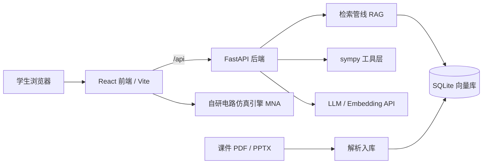

# CourseTA · 开源课程 AI 助教

把任意一门课的课件（PDF / PPTX）变成一位**回答带引用**的 AI 助教。学生随问随答，答案标注 `[来源: 文件名 第X页]`，可逐条核对。

> 面向所有学生的通用工具：不绑定某一门课、某一位老师、某一所学校。上传你课程的材料，它就是你课程的助教。
>
> Turn any course's slides (PDF / PPTX) into a citation-backed AI teaching assistant. Upload your materials, ask questions, verify every answer against the source page.

## 它解决什么问题

- 课件几百页，考前翻不动：直接提问，答案定位到页
- 答疑时间有限：夜间、周末也能得到有材料依据的回答
- 通用聊天机器人容易编造：CourseTA 的答案必须引用课程材料，材料不足会明确说明
- （v0.2 规划）学生提交自己的推导，工具逐步验证，指出**第一个出错的地方**

## 架构



## 功能进度

- [x] 课程管理、材料上传、后台自动解析入库（PDF / PPTX / TXT / MD）
- [x] 带引用的流式问答（SSE）
- [x] sympy 数学工具（解方程、推导步骤等价性验证）
- [x] 自研电路仿真引擎（改进节点法：直流工作点 / 瞬态 / 交流扫频）
- [x] 交互实验台 v0.2：5 个预置实验（分压器 / RC / RL / RC 低通 / RLC 谐振）+ 参数滑块 + 波形与波特图
- [x] 评测集与自动评测脚本（按关键点命中率打分）
- [ ] v0.3 电路自由画布（拖放元件、连线、自定义仿真）
- [ ] v0.4 题目训练：作答步骤级验证（指出第一个出错的步骤）+ 错题本
- [ ] v0.5 知识地图 + 周期复习计划（SM-2 间隔复习）
- [ ] v0.6 多课程公开部署、老师端数据面板

## 快速开始

### 1. 后端（Python ≥ 3.12，使用 uv）

```bash
cd server
uv sync
cp .env.example .env   # Windows: copy .env.example .env
# 编辑 .env，填入 LLM_API_KEY 与 EMBEDDING_*
uv run uvicorn app.main:app --reload
```

### 2. 前端（Node ≥ 20）

```bash
cd web
npm install
npm run dev
```

打开 http://localhost:5173 ：新建课程 → 上传课件 → 提问。

### 配置说明

| 变量 | 说明 |
| --- | --- |
| `LLM_API_KEY` / `LLM_BASE_URL` / `LLM_MODEL` | 任意 OpenAI 兼容对话接口（DeepSeek / Qwen / Ollama…） |
| `EMBEDDING_API_KEY` / `EMBEDDING_BASE_URL` / `EMBEDDING_MODEL` | 向量模型（如 DashScope `text-embedding-v3`、Ollama `bge-m3`）；注意 DeepSeek 暂无 embeddings 接口，需单独配置 |

### 测试与评测

```bash
cd server
uv run pytest                                        # 单元测试
uv run python ../evals/run_eval.py --dry-run         # 校验评测集格式
uv run python ../evals/run_eval.py --course-id 1     # 真实评测（需已配置 .env 且材料已入库）

cd ../web
npm test                                             # 前端测试（仿真引擎 18 个 + 预置实验 14 个用例）
```

## 目录结构

```
course-ta/
├── server/            # FastAPI 后端
│   ├── app/
│   │   ├── api/       # 接口：课程、材料上传、流式聊天
│   │   ├── core/      # LLM 客户端、文档解析、检索、sympy 工具、RAG 管线
│   │   └── models.py  # Course / Material / Chunk
│   └── tests/
├── web/               # React + Vite + TypeScript 前端（src/circuit 仿真引擎、src/labs 预置实验）
├── evals/             # 评测集与评测脚本
└── data/              # 本地数据（课程材料、向量库），已 gitignore
```

## 版权与隐私

- 课程材料保存在本地 `data/` 目录（已 gitignore），不会进入代码仓库
- 请勿把未授权的课程材料上传到公开部署实例
- 引用格式的设计目标：任何回答都能被学生追溯到原始材料的页码
