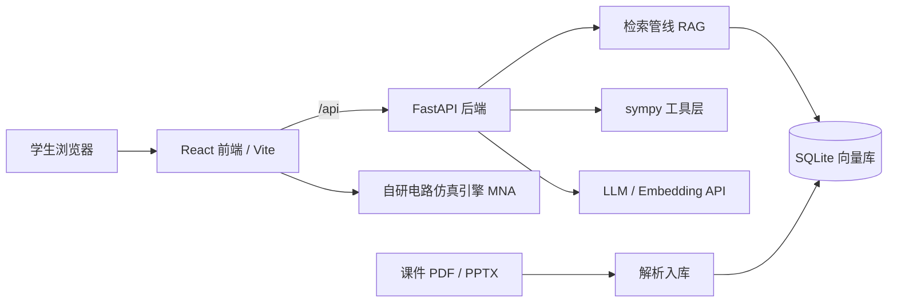

# CourseTA · 开源课程学习平台

把任意一门课的课件（PDF / PPTX）变成**可检索、可练习、可视化的学习系统**：上传课件自动生成知识点总结与讲解（点击知识点直达原页）、按学科脉络自动构建的知识图谱（概念网络含前置关系，点击概念跳原页、连题目）、带引用的 AI 答疑、题库与解答、可自定义公式与符号的计算台、电路仿真实验台。答案标注 `[来源: 文件名 第X页]`，可逐条核对。

> 面向所有学生的通用工具：不绑定某一门课、某一位老师、某所学校。上传你课程的材料，它就是你课程的学习平台。
>
> Turn any course's materials (PDF / PPTX) into a citation-backed learning platform: AI summaries with clickable knowledge points that jump to the source page, an auto-built concept map of the course, practice exam questions with step-level grading, a customizable symbolic-math workspace, and circuit simulation — every AI answer cites its source page.

## 它解决什么问题

- 课件几百页，考前翻不动：直接提问，答案定位到页
- 只想快速回忆一份课件讲了什么：自动生成「整体总结 + 知识点清单」，点击知识点的页码直接跳到原页图，不用逐页翻查
- 复习时理不清整门课的脉络：知识图谱按学习顺序把概念串成网络，标出前置与相关关系，点开概念直达原页与相关真题
- 答疑时间有限：夜间、周末也能得到有材料依据的回答
- 通用聊天机器人容易编造：CourseTA 的答案必须引用课程材料，材料不足会明确说明
- 想刷真题但只有 PDF：试卷自动拆成结构化题目，提交作答后逐步批改，指出出错的位置，错题自动收录

## 架构



## 功能进度

- [x] 课程管理、材料上传、后台自动解析入库（PDF / PPTX / TXT / MD）
- [x] 带引用的流式问答（SSE）
- [x] sympy 数学工具（解方程、推导步骤等价性验证）
- [x] 自研电路仿真引擎（改进节点法：直流工作点 / 瞬态 / 交流扫频）
- [x] 交互实验台 v0.2：5 个预置实验（分压器 / RC / RL / RC 低通 / RLC 谐振）+ 参数滑块 + 波形与波特图
- [x] 评测集与自动评测脚本（按关键点命中率打分）
- [x] v0.3 课程资料分区：材料分类浏览、分页阅读器、全文搜索、引用跳转 + 分区导航（资料 / 题库 / 图谱 / 实验台）
- [x] v0.3.1 解析与排版质量：PyMuPDF 版面级抽取（保留换行与结构）、PPT 层级结构、助教解答 Markdown + KaTeX 公式渲染
- [x] v0.4 题库与解答：真题自动解析为结构化题目（题干 + 参考答案 + 知识点标签）、按材料 / 知识点 / 练习状态筛选、作答步骤级批改（正确 / 部分正确 / 错误）、结合课程材料的 AI 详解、错题本、原题页图回看
- [x] v0.4.1 解析管线 v2：行聚类重建视觉行（修复 2D 公式/矩阵被拆成碎片行）、特殊字体与乱码解码（Symbol / Wingdings / PUA / 异体字符表）、大定界符组合件合并、LLM 语义修复（乱码或碎片页面自动整理为 Markdown + LaTeX）
- [x] v0.4.2 材料知识点总结：上传后自动生成「整体总结 + 知识点清单」（理工科优化：定义 / 定理 / 关键公式 / 方法优先），知识点带来源页码、点击直达原页图或原文；支持一键重新生成
- [x] v0.4.3 计算台：sympy 符号计算（化简 / 求导 / 积分 / 极限 / 级数 / 拉普拉斯与逆变换 / 解方程 / 行列式 / 特征值 / 复变留数等 20+ 操作），支持 LaTeX 与普通语法输入、实时预览、数值近似；预置 24 条常用公式（高数 / 线代 / 物理 / 电子 / 复变）并可自由新增编辑，符号可自定义类型（实数 / 正数 / 整数 / 复数）
- [x] v0.5 知识图谱：从材料总结两级抽取（按材料归纳候选概念 → 全局合并为脉络），输出课程总览、模块分组、概念解释与「前置 / 相关」关系；交互式概念网络（模块分带着色、滚轮缩放、拖拽平移），概念锚定到原始课件页码（点击跳原页），并自动关联题库中知识点匹配的真题（点击直达题目）
- [x] v0.5.1 计算台增强：按普适数学分支分类（微积分 / 代数 / 变换 / 线性代数 / 复数 / 物理与工程），新增偏导数、泰勒展开、傅里叶变换（ω 约定）/逆变换、定积分上下限与数值近似兜底；预置公式扩充到 35 条并随版本自动迁移；输入兼容混用花括号的写法（如 `e^{-x^2}`）
- [ ] v0.6 复习计划：基于题库与图谱的 SM-2 间隔复习与周期计划
- [ ] v0.7 多课程公开部署、老师端数据面板

## 快速开始

### 1. 后端（Python ≥ 3.12，使用 uv）

```bash
cd server
uv sync
cp .env.example .env   # Windows: copy .env.example .env
# 编辑 .env，填入 LLM_API_KEY 与 EMBEDDING_*
uv run uvicorn app.main:app --reload
```

### 2. 前端（Node ≥ 20）

```bash
cd web
npm install
npm run dev
```

打开 http://localhost:5173 ：新建课程 → 上传课件。上传后系统自动解析入库并生成「知识点总结」：打开材料默认看到整体总结与知识点清单（含公式渲染），点击知识点旁的页码直接跳到原页图；右上「原文 / 原页图」标签可切换逐页阅读，上方可全文搜索，需要时拉起右栏「问助教」，引用可点击跳页。

切换到「知识图谱」分区：点「生成」后，AI 通读该课程全部材料总结，归纳课程总览、按学习顺序排列的知识模块、概念解释与前置 / 相关关系，在画布上生成可交互概念网络（模块按顺序自上而下分带着色、滚轮缩放、拖拽平移、左侧列表搜索）。点击任一概念：右侧显示解释与关联概念，可一键跳到出处课件的对应页码，并列出知识点标签匹配的真题（点击直达题库作答）。

切换到「计算台」分区：左侧公式库预置 35 条常用公式，按普适数学分支组织（微积分 / 代数 / 变换 / 线性代数 / 复数 / 物理与工程，可新增、编辑、删除），点公式即插入表达式；输入支持 LaTeX（`\int_0^{\infty} e^{-x^2} dx`）与普通语法（`x^3-3x+2`、`e^{-x^2}`），可选择求导 / 偏导 / 定积分（填上下限）/ 极限 / 泰勒展开 / 傅里叶与拉普拉斯变换 / 解方程 / 矩阵运算 / 复变函数等操作，结果 KaTeX 渲染并给出数值近似；右侧可自定义符号及其类型（如实数 / 正数 / 整数），让化简结果符合物理语境。

切换到「题库与解答」分区：在左侧找到真题材料点「提取」，AI 会把试卷拆成结构化题目（题干、参考答案、知识点标签）；点开题目即可作答、提交批改（分步点评 + 判定）、生成结合课程材料的 AI 详解；判定为「错误 / 部分正确」的题自动进入错题本。批量提取全部真题可用：

```bash
cd server
uv run python scripts/extract_problems.py --all        # 或 --material-id 3
uv run python scripts/summarize.py --missing-only      # 为尚未总结的材料批量生成知识点总结
uv run python scripts/build_graph.py --course-id 1     # 生成课程知识图谱（需先完成材料总结）
```

### 配置说明

| 变量 | 说明 |
| --- | --- |
| `LLM_API_KEY` / `LLM_BASE_URL` / `LLM_MODEL` | 任意 OpenAI 兼容对话接口（DeepSeek / Qwen / Ollama…） |
| `EMBEDDING_API_KEY` / `EMBEDDING_BASE_URL` / `EMBEDDING_MODEL` | 向量模型（如 DashScope `text-embedding-v3`、Ollama `bge-m3`）；注意 DeepSeek 暂无 embeddings 接口，需单独配置 |
| `EXTRACT_MODEL` | 题目抽取专用模型（可选，默认同 `LLM_MODEL`）。抽取是一次性批量任务，建议用更强的模型保证公式与结构质量 |

### 测试与评测

```bash
cd server
uv run pytest                                        # 单元测试
uv run python ../evals/run_eval.py --dry-run         # 校验评测集格式
uv run python ../evals/run_eval.py --course-id 1     # 真实评测（需已配置 .env 且材料已入库）

cd ../web
npm test                                             # 前端测试（仿真引擎 18 个 + 预置实验 14 个 + 计算台 13 个 + 图谱布局 6 个用例）
```

## 目录结构

```
course-ta/
├── server/            # FastAPI 后端
│   ├── app/
│   │   ├── api/       # 接口：课程、材料、资料浏览、材料总结、知识图谱、流式聊天、题库（抽取 / 批改 / 详解 / 错题本）、计算台与公式库
│   │   ├── core/      # LLM 客户端、文档解析、检索、sympy 工具与符号计算内核、RAG、题目抽取与批改、材料总结、图谱抽取
│   │   └── models.py  # Course / Material / Chunk / Problem / Attempt / Summary / Formula / CourseGraph / Concept / ConceptEdge
│   ├── scripts/       # 重新索引、批量真题抽取、批量总结、图谱生成 CLI
│   └── tests/
├── web/               # React + Vite + TypeScript 前端（src/sections 分区页面、src/compute 计算台、src/graph 图谱布局、src/circuit 仿真引擎、src/labs 预置实验）
├── evals/             # 评测集与评测脚本
└── data/              # 本地数据（课程材料、向量库），已 gitignore
```

## 版权与隐私

- 课程材料保存在本地 `data/` 目录（已 gitignore），不会进入代码仓库
- 请勿把未授权的课程材料上传到公开部署实例
- 引用格式的设计目标：任何回答都能被学生追溯到原始材料的页码

## 许可证

[MIT](LICENSE)
